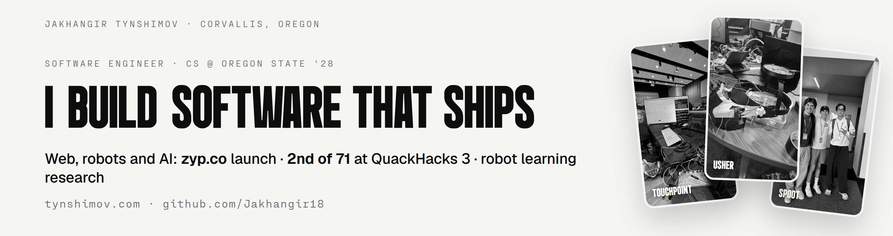
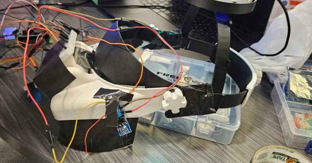
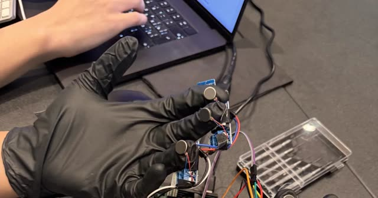
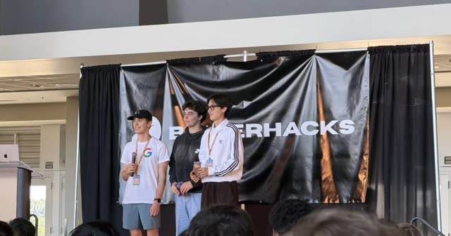
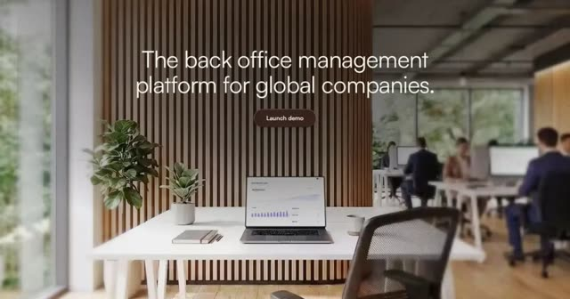
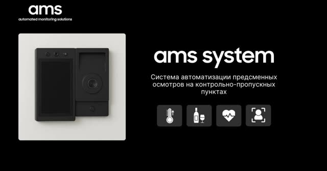
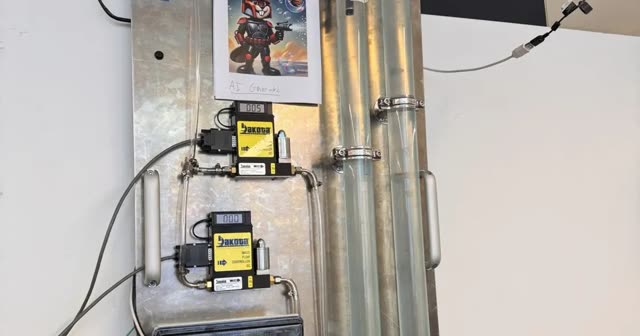

<picture>
  <source media="(prefers-color-scheme: dark)" srcset="assets/header-dark.webp">
  
</picture>

Hi, I'm Jak. I study computer science at Oregon State ('28) and build software that reaches into the physical world: haptic wearables, robot learning in simulation, and production web.

Portfolio with a case study for every project: **[tynshimov.com](https://www.tynshimov.com)** · [LinkedIn](https://www.linkedin.com/in/tynshimov)

### Now

| | |
|---|---|
| **Research** | Robot arm and hand in MuJoCo in Prof. Raffaele De Amicis's lab at Oregon State: reinforcement learning in MuJoCo Playground, imitation learning with LeRobot and ACT, VR teleoperation. Work in progress: [drone-sim](https://github.com/Jakhangir18/drone-sim) |
| **Leading** | President of Google Developer Group on Campus at Oregon State, 200+ students registered. [What we do](https://www.tynshimov.com/work/gdg/) |
| **Shipped** | Software engineer intern at Zyp (Aug–Sep 2026): built and launched [www.zyp.co](https://www.zyp.co), 67 of its 68 pull requests. Astro + TypeScript, a scroll-scrubbed canvas hero, Playwright + axe tests, Lighthouse 100 on desktop. [Case study](https://www.tynshimov.com/work/zyp/) |

### Selected builds

<table>
  <tr>
    <td width="50%" valign="top">
      <a href="https://github.com/Jakhangir18/Usher"></a>
      <br><b><a href="https://github.com/Jakhangir18/Usher">Usher</a></b> · Team lead, MHacks 2026
      <br>A headset for people with Usher syndrome: say "Hello Jax" and a buzz on the temple turns the wearer toward the speaker. Runs offline on a Raspberry Pi.
      <br><sub>Python · Whisper · reSpeaker mic array · haptics · <a href="https://devpost.com/software/usher">Devpost</a> · <a href="https://www.tynshimov.com/work/usher/">write-up</a></sub>
    </td>
    <td width="50%" valign="top">
      <a href="https://github.com/Jakhangir18/touchpoint"></a>
      <br><b><a href="https://github.com/Jakhangir18/touchpoint">TouchPoint</a></b> · 2nd of 71, QuackHacks 3
      <br>Gloves that play Grade 1 Braille on the fingertips so a blind user can browse the web by touch. I designed the Raspberry Pi motor driver board.
      <br><sub>Raspberry Pi · Flask · Playwright · Gemini · <a href="https://www.youtube.com/watch?v=Pg9wEbOyQJY">demo</a> · <a href="https://www.tynshimov.com/work/touchpoint/">write-up</a></sub>
    </td>
  </tr>
  <tr>
    <td width="50%" valign="top">
      <a href="https://github.com/Jakhangir18/spoot"></a>
      <br><b><a href="https://github.com/Jakhangir18/spoot">SPOOT</a></b> · 3rd, Google's Best Use of Gemini, BeaverHacks 2026
      <br>3D-printed glasses that show where a sound came from and whether it matters. I built the phone AR layer, the glasses and the Pi bring-up.
      <br><sub>Raspberry Pi · faster-whisper · Gemini Flash · PWA · <a href="https://www.youtube.com/watch?v=r0NJpTgAblA">demo</a> · <a href="https://www.tynshimov.com/work/spoot/">write-up</a></sub>
    </td>
    <td width="50%" valign="top">
      <a href="https://www.tynshimov.com/work/zyp/"></a>
      <br><b><a href="https://www.zyp.co">zyp.co</a></b> · Shipped at Zyp, 2026
      <br>The company's public site, first commit to launch in four weeks. Peak decoded-frame memory cut from 995 MB to 149 MB with a sliding ImageBitmap window.
      <br><sub>Astro · TypeScript · GSAP · Canvas 2D · Playwright · <a href="https://www.tynshimov.com/work/zyp/">case study</a></sub>
    </td>
  </tr>
  <tr>
    <td width="50%" valign="top">
      <a href="https://www.tynshimov.com/projects/ams/"></a>
      <br><b><a href="https://www.tynshimov.com/projects/ams/">AMS Tablet</a></b> · Automated Monitoring Solutions, 2024–2025
      <br>Pre-shift inspection and workforce verification at industrial checkpoints in Aktau, Kazakhstan: Raspberry Pi edge units, YOLO + Frigate person detection, a cloud dashboard.
      <br><sub>Python · React · TypeScript · Docker · Raspberry Pi</sub>
    </td>
    <td width="50%" valign="top">
      <a href="https://www.tynshimov.com/work/remote-lab-vision/"></a>
      <br><b><a href="https://www.tynshimov.com/work/remote-lab-vision/">Remote Lab Vision</a></b> · URSA Engage research, Oregon State
      <br>Which camera can hold a readable feed of a remote chemistry lab inside LabVIEW: four cameras benchmarked on delivered resolution, frame rate and RGB histograms.
      <br><sub>LabVIEW · NI-IMAQdx · machine vision</sub>
    </td>
  </tr>
</table>

Also: [NBA Predictors](https://devpost.com/software/nba-predictors), winner of the GDG Winter 2026 Hackathon (React Native, Supabase, ML projections) · [see-ai](https://github.com/Jakhangir18/see-ai), YOLOv8 object detection running in the browser · [commitweather](https://github.com/Jakhangir18/commitweather), commit history turned into a weather landscape · [ai-debate-arena](https://github.com/Jakhangir18/ai-debate-arena), GPT-4o and GPT-4o-mini argue a question and a judge model rules · [this site's source](https://github.com/Jakhangir18/works-only-project-)

### Toolkit

```text
languages     Python · TypeScript · JavaScript · C++
web           Astro · React · Next.js · GSAP · Canvas 2D · Playwright · Supabase · Vercel
robots + ML   MuJoCo · reinforcement learning · imitation learning · YOLO · OpenCV · ONNX Runtime Web
hardware      Raspberry Pi · Arduino · circuit design · soldering · 3D printing · Fusion 360
```

### Recently pushed

<!-- recent:start -->
| Repository | What it is | Last push |
|---|---|---|
| [drone-sim](https://github.com/Jakhangir18/drone-sim) | MuJoCo simulation of a robot arm and hand for VR teleoperation research at Oregon State (in progress) | Oct 15, 2026 |
| [ai-debate-arena](https://github.com/Jakhangir18/ai-debate-arena) | Two models argue it out: GPT-4o as a YC partner vs GPT-4o-mini as a senior engineer, then a judge model rules | Oct 12, 2026 |
| [see-ai](https://github.com/Jakhangir18/see-ai) | Real-time YOLOv8n object detection in the browser with ONNX Runtime Web; no server, inference runs on the device | Oct 12, 2026 |
| [commitweather](https://github.com/Jakhangir18/commitweather) | Turns a GitHub user's commit activity into a generated weather landscape. Next.js + TypeScript | Oct 12, 2026 |
| [sadap-clinicAMS](https://github.com/Jakhangir18/sadap-clinicAMS) | Next.js + Supabase site for a clinic in Aktau: doctors directory and an admin dashboard with doctor CRUD and certificate uploads | Oct 12, 2026 |
<!-- recent:end -->

<picture>
  <source media="(prefers-color-scheme: dark)" srcset="assets/braille-dark.svg">
  
</picture>

<sub>My name in Grade 1 Braille. Off the keyboard I play chess.</sub>
